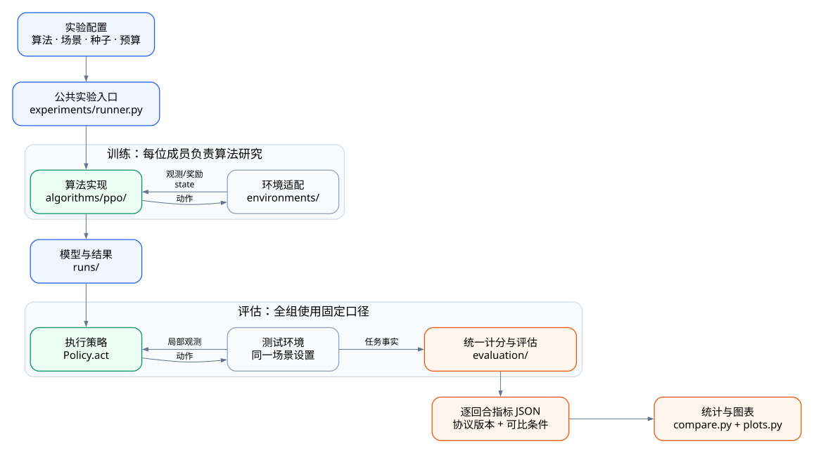

# 多智能体强化学习算法对比

我们让多个智能体在仿真里学会分工或对抗。用同一套命令，可以在 Spread 中比较不同算法怎样分头覆盖目标，也可以让同一个算法换到 Tag 里追捕。项目还接入了合作采集、仓储和 MuJoCo 双臂任务。

## 快速开始

先在终端进入仓库根目录（能看到 `pyproject.toml` 和 `configs/`）。下面用 CPU 训练一个 IPPO 模型，让三个智能体在 Spread 中覆盖三个目标。

### 1. 安装

WSL 或 Ubuntu 已装 Miniconda 时，运行：

```bash
conda create -n deeprl-teamwork --override-channels -c conda-forge python=3.12 pip
conda activate deeprl-teamwork
python -m pip install "torch==2.7.1+cpu" --index-url https://download.pytorch.org/whl/cpu
env -u PYTHONPATH python -m pip install -r requirements.txt
```

已有 `deeprl-teamwork` 时，激活后执行最后一行。原生 Windows 或没有 Conda 时，请按 [安装指南](docs/guides/SETUP.md#使用项目虚拟环境的安装方式) 操作。

```bash
python -m teamwork.cli doctor
```

看到 Python、Torch 和 MPE2 的版本，就可以继续。使用 CPU 时，`cuda_available: false` 是正常的。

### 2. 训练、评估并画图

依次运行下面三条命令。重复练习时，把三条命令里的 `runs/first-spread` 一起改成一个新目录。

```bash
python -m teamwork.cli train --config configs/algorithms/ippo.yaml --env spread --steps 1024 --seed 0 --out runs/first-spread
python -m teamwork.cli evaluate --checkpoint runs/first-spread/model.pt --episodes 5 --seed 10000 --out runs/first-spread/eval.json --gif runs/first-spread/replay.gif
python -m teamwork.cli plot --csv runs/first-spread/episodes.csv --out runs/first-spread/training.png
```

打开本地 `runs/` 下的 `first-spread`：

- `model.pt` 是训练保存的模型。评估命令会从这里读取场景和模型参数。
- `eval.json` 的 `summary` 有 5 个测试回合的平均分，`replay.gif` 播放其中第一个回合。
- `training.png` 是训练时的回报曲线，原始记录在 `episodes.csv`。

这次只跑 1,024 步，用于检查训练流程。正式比较请使用 [Spread 基准](docs/experiments/README.md#spread-统一基准) 和对应场景的 [评分规则](docs/experiments/README.md#场景与指标)。

### 3. 找到第一处要改的文件

| 想做什么 | 从哪里开始 |
|---|---|
| 调一个训练参数 | 复制 [IPPO 的 YAML](configs/algorithms/ippo.yaml)，改 `lr` 等参数，再把新文件交给 `--config`。 |
| 改进或新增算法 | 打开 [算法目录](docs/algorithms/README.md)，找算法名对应的配置和 [实现](src/teamwork/algorithms/)。新算法按 [开发指南](docs/guides/DEVELOPMENT.md#新增算法) 接入。 |
| 接入一个仿真场景 | 先看 [Spread 的环境入口](src/teamwork/environments/spread/environment.py)，再按 [环境指南](docs/environments/README.md#接入或编写环境) 登记场景。 |
| 看懂或调整评分 | 先运行 `python -m teamwork.cli metrics --env spread`，再看 [Spread 的计分代码](src/teamwork/evaluation/metrics/spread/rules.py)。 |

第一次改代码后，可以先跑和改动有关的 [pytest 测试](tests/)，再重跑上面的短训练。 [开发指南里的命令](docs/guides/DEVELOPMENT.md#检查改动)

## 项目资料

- [组内分工和算法配置](docs/algorithms/README.md#分工内容)
- [MuJoCo 双臂交接的复现步骤](docs/environments/README.md#mujoco-双臂交接)
- [文档导航](docs/README.md)


