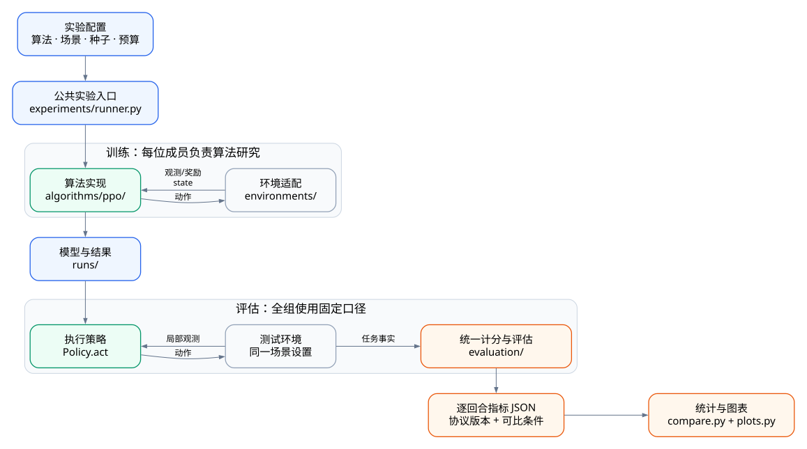

# 多智能体强化学习算法对比

研究：**同场景比较算法，同算法跨场景验证。** 每人认领至少2个DRL算法，共用环境和固定指标。
目前可运行 IPPO、集中 critic PPO（配置名 `mappo`，不是完整 MAPPO 复现），其余 **参考算法** 见 [算法清单与认领](docs/ALGORITHMS.md)。

## 目录结构

```text
src/teamwork/
├── algorithms/                 ← 主要工作区：各自的算法
│   ├── base.py                 # Algorithm / Policy 公共合同
│   ├── registry.py             # 新算法在这里注册
│   ├── baselines.py            # 随机与规则对照
│   └── ppo/                    # 现有 IPPO / 集中 critic PPO
│       ├── algorithm.py        # 接口、策略动作与模型加载
│       └── trainer.py          # 网络、采样、损失与参数更新
├── environments/               ← 接入或修改仿真环境
│   ├── base.py                 # Environment 合同与空间描述
│   ├── registry.py             # 环境工厂注册
│   ├── mpe.py                  # MPE2 Spread / Tag
│   └── gym_tuple.py            # LBF / RWARE 共同适配
├── evaluation/                 ← 全组共同维护，算法不自行计分
│   ├── metrics.py              # 每个场景的固定指标和默认条件
│   ├── evaluator.py            # 运行模型，输出逐回合指标
│   ├── compare.py              # 可比性检查与跨训练种子汇总
│   └── plots.py                # 训练曲线与算法对比图
├── experiments/runner.py        ← 实验调度、种子、预算、耗时
└── cli.py                      ← 命令行参数，不放算法实现

configs/algorithms/ppo.yaml      # 当前 PPO 家族的共用参数起点
tests/                          # 按 algorithms / environments / evaluation 对应放测试
scripts/setup.py                # Windows / Ubuntu 共用安装入口
scripts/smoke.py                # 测试、训练、评估、图表的一键验收
docs/                           # 算法清单、固定指标、安装说明
runs/                           # 自动生成的模型和结果，不提交 Git
```



## 开发新算法配置

1. `src/teamwork/algorithms/<方法名>/`：实现 `Algorithm` 和 `Policy`，训练循环由方法自己决定。
2. `algorithms/registry.py`：调用 `register_algorithm("方法名", YourAlgorithm)`。
3. `configs/algorithms/<方法名>.yaml`：写该方法的配置，不沿用其他算法的超参数。
4. `tests/algorithms/test_<方法名>.py`：验证更新、保存加载和适用场景。

改环境写 `environments/`；定义指标写 `evaluation/metrics.py`；改绘图写 `evaluation/plots.py`。
当前只支持固定 agent、向量观测和离散动作；不要为尚未实现的方法建立空目录。

## 运行示例（以Windows为例）

> 在Linux,macOS上的环境配置问题,可以参考 [SETUP](docs/SETUP.md)

```powershell
.\.venv\Scripts\python.exe -m teamwork.cli train --config configs/algorithms/ppo.yaml --algorithm ippo --env spread --steps 2048 --out runs/ippo_spread_s0
.\.venv\Scripts\python.exe -m teamwork.cli evaluate --checkpoint runs/ippo_spread_s0/model.pt --episodes 10 --out runs/ippo_spread_s0/eval.json --gif runs/ippo_spread_s0/demo.gif
```

切换场景用 `--env`，切换已注册方法用 `--algorithm`。Tag 比较需固定另一方；详见 [固定指标与比较规则](docs/EXPERIMENTS.md)。
备用环境资料在 [references](docs/references/ENVIRONMENTS.md)。

`.github/` 保留 CI 与协作模板，`.vscode/` 只是编辑辅助；环境、缓存、`*.egg-info` 等自动目录无需阅读或提交。

<details>
<summary>接入时需要遵守的接口与输出格式</summary>

- 环境返回按 agent 命名的字典，保留 `terminated/truncated`；训练 critic 可用 `state()`，actor 只用自己的观测。
- `task_snapshot()` 仅供评估，不作为执行策略输入；循环策略在每回合 `Policy.reset()` 清空隐藏状态。
- `Algorithm.train(config, out)` 返回模型路径，预算按联合环境 step，不能覆盖已有实验。
- 保存 `config.json`、`episodes.csv`、模型；公共入口另写 `training.json`。CSV 含 episode、steps 与各 agent 回报。
- 检查点用 `torch.save({"config": config, "steps": 实际步数, ...自有状态...}, path)`，内容为 tensors/基础类型。
- 算法自行实现 `load_policy`；现有 PPO 检查点支持评估，不含完整续训状态。跨场景通常需要重新训练。

</details>
